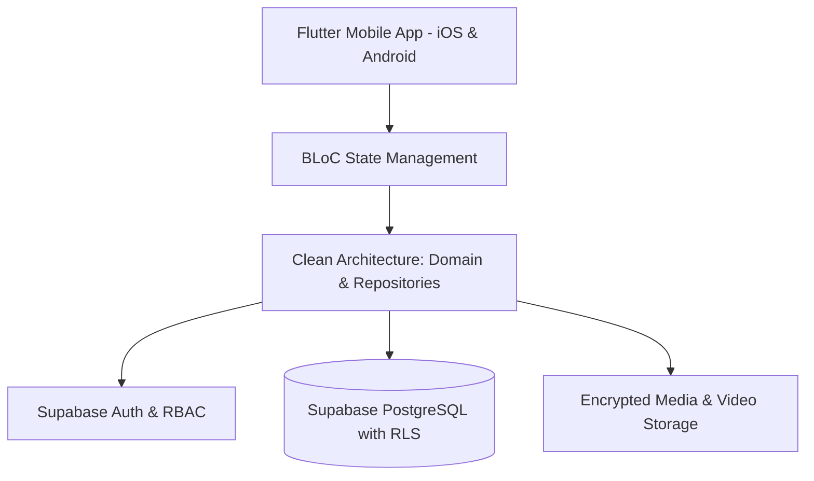

# Team-AR — Coaching & Athletic Performance Platform

A production-grade mobile fitness, coaching, and nutrition tracking platform built as a commercial freelance engagement. Serves coaches and trainees with dedicated, isolated workflows, live workout session execution, and granular nutritional adherence tracking.

---

## 🌟 Key Capabilities

### 1. Granular Role-Based Access Control (RBAC)
* Powered by **Supabase Row-Level Security (RLS)** to cleanly separate coach administration from trainee activities.
* **Coach Workflows:** Build customized multi-day workout routines, specify intensity parameters (RIR, Tempo, Rest Intervals), and design tailored macronutrient meal plans.
* **Trainee Workflows:** View scheduled workout days, log sets/reps in real-time, and track daily hydration and macronutrient intake.

### 2. Live "Focus Mode" Workout Execution
* Interactive workout screen guiding the athlete through each exercise with demonstration videos.
* Automated rest interval timer triggered instantly upon completing a set.
* Persistent state handling to safeguard session progress against app restarts or incoming phone calls.

### 3. Nutrition & Adherence Engine
* Gram-level macronutrient calculations (Protein, Carbs, Fats) and calorie targets.
* Real-time hydration counter tracking water consumption against personalized daily targets.
* Coach-facing adherence dashboards highlighting trainee consistency and historical weight progression.

---

## 🏛️ System Architecture

---

## 🛠️ Tech Stack

* **Framework:** Flutter (iOS & Android)
* **Language:** Dart
* **Backend:** Supabase (PostgreSQL, Row-Level Security, Auth, Realtime)
* **Architecture:** Clean Architecture with Feature-First structure
* **State Management:** BLoC
* **Media:** Video Player, Cached Network Image, PDF viewer
